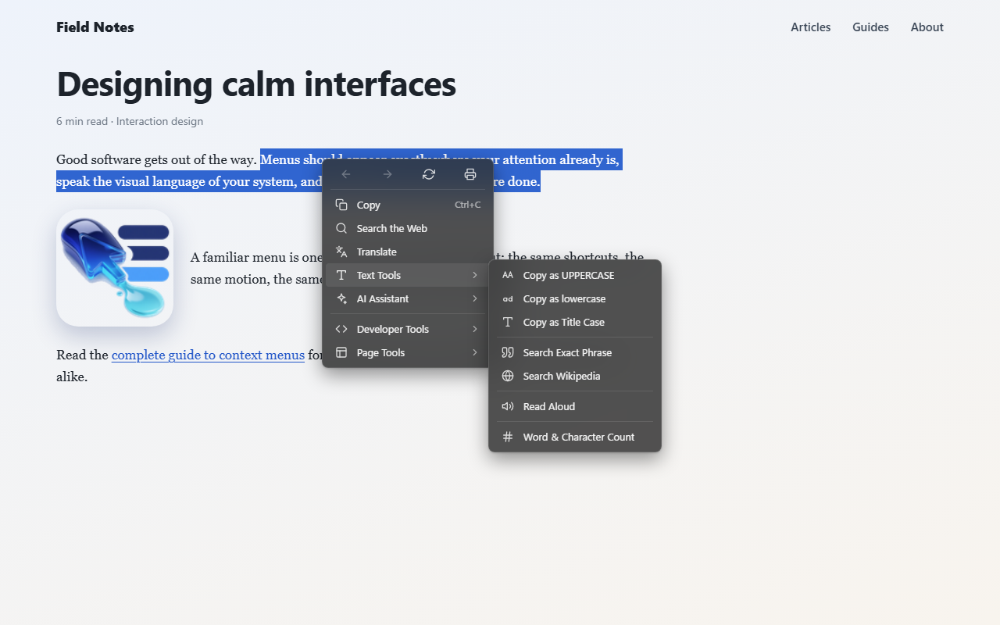
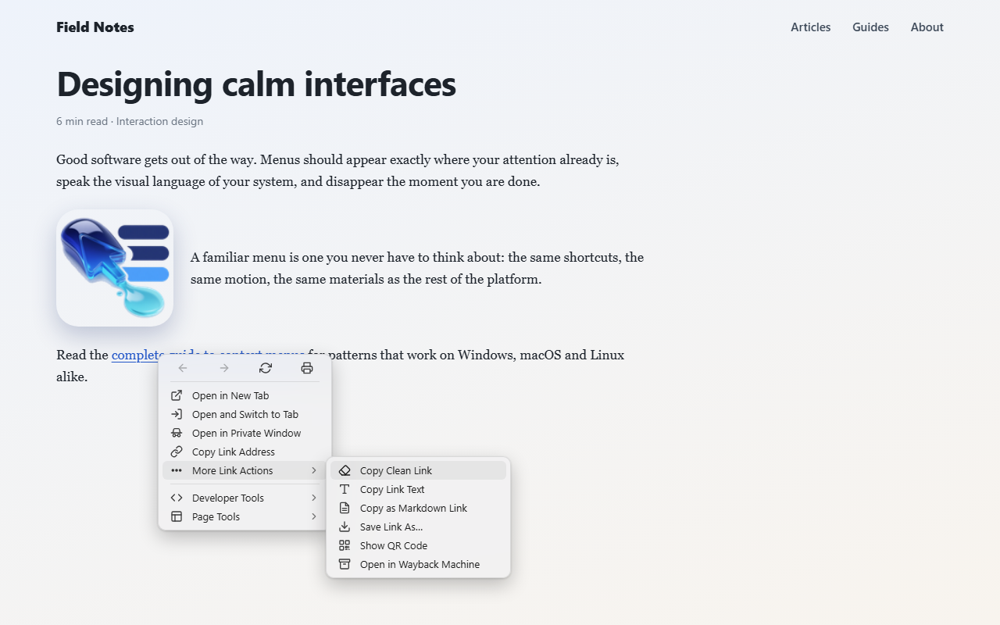
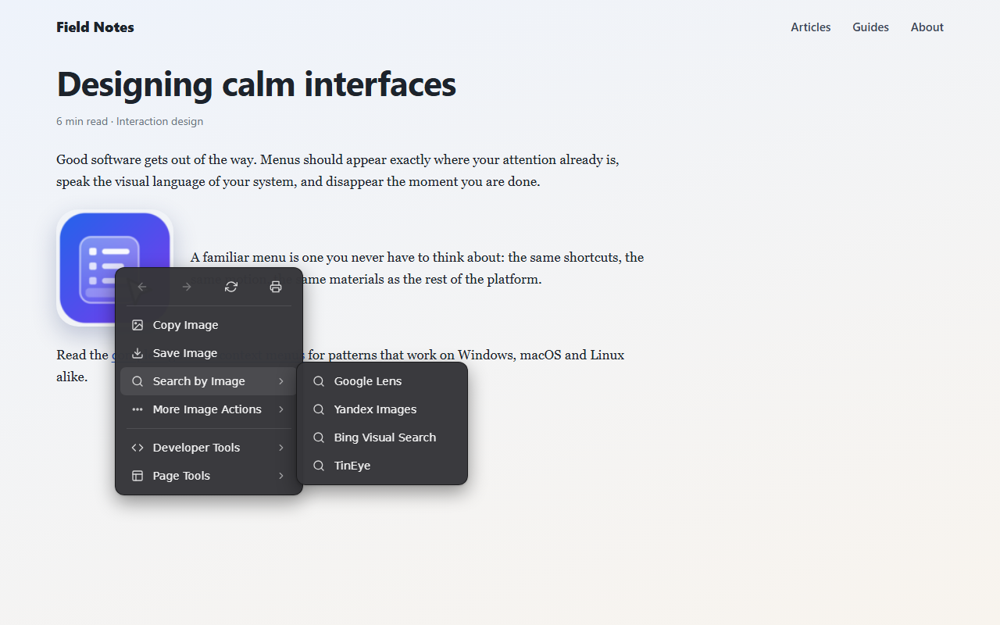
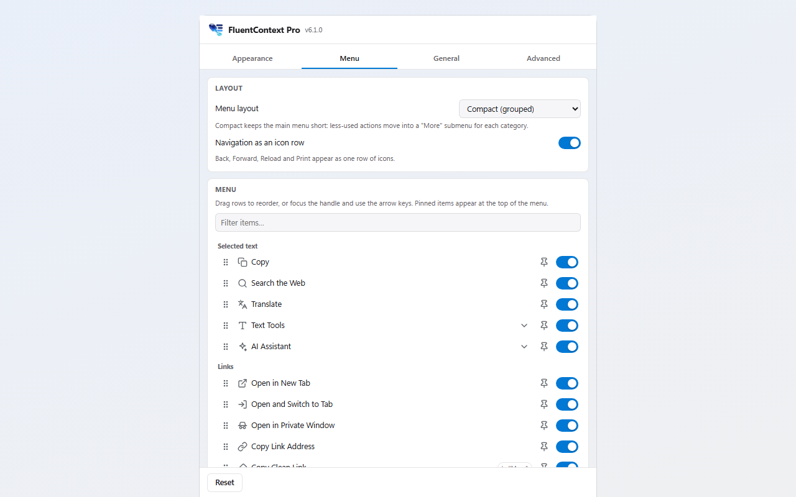

<p align="center">
  
</p>

<h1 align="center">FluentContext Pro</h1>

<p align="center">
  <strong>A fast, customizable right-click menu that looks native on Windows, macOS and Linux.</strong><br />
  Copy, search, translate, save, inspect and send to your own AI, all one click away.
</p>

<p align="center">
  <a href="https://github.com/oguztozkoparan/fluent-context-pro/actions/workflows/ci.yml"></a>
  <a href="https://github.com/oguztozkoparan/fluent-context-pro/releases/latest"></a>
  
  <a href="LICENSE"></a>
  
</p>

<p align="center">
  <a href="#features">Features</a> ·
  <a href="#install">Install</a> ·
  <a href="#privacy">Privacy</a> ·
  <a href="#development">Development</a> ·
  <a href="CHANGELOG.md">Changelog</a>
</p>

<p align="center">
  
</p>

## Why FluentContext Pro

The browser's own right-click menu is long, looks the same everywhere and leaves out the things you
do every day. FluentContext Pro replaces it with a short, fast menu that matches your operating system
and puts the actions you actually use within one click. It has no account, no analytics and no
dependencies.

## Features

### Looks like your system

- **Windows 11 (Fluent)**, **macOS** and **Linux (GNOME)** styles, picked automatically
- Light and dark themes, accent color, a neutral or accent-colored highlight, transparency, corner radius, font size and animation
- Shortcut labels that match your keyboard: `Ctrl` on Windows and Linux, `⌘` on macOS

<table>
  <tr>
    <td></td>
    <td></td>
  </tr>
  <tr>
    <td align="center">macOS</td>
    <td align="center">Linux (GNOME)</td>
  </tr>
</table>

### Short by design

- **Compact layout:** the main actions stay on top, the rest move into a "More" submenu. A link menu
  shows 5 rows instead of 16.
- Back, Forward, Reload and Print as a single row of icons
- Pin favorites to the top, drag to reorder, switch off anything you never use

### Useful actions

| On | What you can do |
|---|---|
| **Text** | Copy, search, translate, change case, word and character count, read aloud, copy as Markdown |
| **Links** | Open in a new tab (in the background or switching to it) or a private window, copy a clean link without tracking parameters, QR code, Wayback Machine |
| **Images** | Copy, save, search by image (Google Lens, Bing, Yandex, TinEye), extract text (OCR), read Stable Diffusion / ComfyUI prompt metadata |
| **Video** | Picture-in-Picture, playback speed, loop, copy the current frame |
| **Page & dev** | Per-site dark mode, screenshot, color picker, CSS selector, Tailwind classes |
| **Your own** | Open any URL template, or send the selection to your own AI model (LM Studio, Ollama, any OpenAI-compatible endpoint) with streaming answers |

### Settings that stay out of the way

Everything is configured from the toolbar popup, with a live preview of the menu. Settings sync
through your browser account and can be exported and imported as a file.

<p align="center">
  
</p>

### Languages

English, Türkçe, Deutsch, Français, Español and Русский. The interface follows your system language
automatically.

## Install

Store listings for Chrome, Edge, Firefox and Opera are on the way. Until then, install from a release:

1. Download the ZIP for your browser from the [latest release](https://github.com/oguztozkoparan/fluent-context-pro/releases/latest).
2. **Chrome, Edge, Opera, Brave:** unzip it, open the extensions page (`chrome://extensions`,
   `edge://extensions`, …), turn on **Developer mode**, choose **Load unpacked** and select the
   unzipped folder.
3. **Firefox:** install the signed `.xpi` from the release page when one is attached. Otherwise open
   `about:debugging` → **This Firefox** → **Load Temporary Add-on…** and pick `manifest.json` from
   the unzipped Firefox build.

Requires Chrome 116 or newer, or a current version of Firefox, Edge or Opera.

### Good to know

- **Shift + right-click** always opens the browser's own menu.
- Text fields keep the browser's menu, so spelling suggestions and paste work as usual.
- Web pages cannot open the menu or trigger its actions: synthetic, script-generated events are ignored.

## Privacy

- No analytics, no tracking, no account.
- Nothing leaves your browser unless you choose an action that needs a service: a search, OCR, or
  your own AI endpoint.
- Settings sync through your browser account. API keys stay on this device.

Read the full [privacy policy](PRIVACY.md) and the [security policy](SECURITY.md).

## Development

Requires Node.js 22 or newer for the tooling. The extension itself has no dependencies and no build
step: the repository root is a loadable extension.

```bash
git clone https://github.com/oguztozkoparan/fluent-context-pro.git
```

- **Chrome / Edge / Opera / Brave:** open the extensions page, enable developer mode, choose
  "Load unpacked" and select the repository folder.
- **Firefox:** run `npm run build`, then open `about:debugging` → This Firefox → "Load Temporary Add-on…"
  and pick `dist/firefox/manifest.json`.

### Scripts

| Command | What it does |
|---|---|
| `npm run check` | Static quality gate: syntax, manifest references, versions, permissions, unsafe APIs, translations, size budget |
| `npm test` | Unit tests (modules, settings migration, update checks, background validation) |
| `npm run build` | Writes loadable copies to `dist/chromium` and `dist/firefox` |
| `npm run package` | Builds every target and store-ready ZIPs in `dist/` |
| `npm run test:e2e` | Loads the extension into headless Chrome and drives it with real input |
| `npm run lint:firefox` | Mozilla's add-ons linter on the Firefox build |
| `npm run screenshots` | Regenerates store images in `docs/store/images/` |
| `npm run verify` | Everything above that CI runs, in order |

### Project layout

```
manifest.json         Chromium manifest (Firefox variant generated by scripts/build.mjs)
background.js         Service worker / event page: tabs, downloads, OCR, AI streaming, updates
icons/                Extension icons (16, 32, 48, 128)
src/
  items.js            Every menu item — the single source for the menu, settings and defaults
  menu-view.js        Menu renderer and interaction engine (also used by the settings preview)
  theme.js            Windows / macOS / Linux looks as CSS variables
  config.js           Settings defaults, validation, sync/local storage, migrations
  updates.js          Store update handling and GitHub release checks
  content/            In-page layer, controller, early dark-mode script
  i18n/               Runtime translations (menu strings are loaded in pages, settings strings only in the popup)
popup/                Settings page (toolbar popup and options tab)
scripts/              build, zip, check, release, screenshots
tests/                unit tests, headless Chrome end-to-end tests, fixtures
docs/
  brand/              Logo sources (full logo, symbol, original artwork)
  store/              Listing texts, promo page and store images
```

### Versioning and releases

Versions follow [Semantic Versioning](https://semver.org/). `package.json` and `manifest.json` always
carry the same version; `npm run check` fails otherwise.

1. Describe changes under **Unreleased** in [CHANGELOG.md](CHANGELOG.md).
2. Run `npm run release -- patch` (or `minor`, `major`, `x.y.z`). This bumps both files, moves the
   changelog notes under the new version, commits `chore(release): vX.Y.Z` and tags `vX.Y.Z`.
3. Push with `git push --follow-tags`. The **Release** workflow verifies the tag, runs every check,
   builds the ZIPs and publishes a GitHub Release with the changelog as notes.

The **Bump version** workflow does steps 2 and 3 from the GitHub Actions tab. **Publish to stores**
uploads a release to the Chrome, Edge and Firefox stores once their API secrets are configured.

### Continuous integration

| Workflow | Trigger | Jobs |
|---|---|---|
| CI | push to `main`, pull requests | check, unit tests, package, Firefox lint, headless Chrome e2e, upload ZIPs |
| Release | `v*` tag or manual | verify tag, full test run, GitHub Release with ZIPs (and a signed self-hosted Firefox build if AMO keys exist) |
| Bump version | manual | bump, commit, tag, push, start Release |
| Publish to stores | manual | upload a release to the stores that have secrets |
| CodeQL | push, PR, weekly | JavaScript security analysis |

### Store submission

The store submission guide (Turkish) is in [docs/STORE.md](docs/STORE.md), and the listing texts are
in [docs/store/listing.md](docs/store/listing.md).

## Contributing

Bug reports and ideas are welcome in [GitHub Issues](https://github.com/oguztozkoparan/fluent-context-pro/issues).
For pull requests, run `npm run verify` before opening one and add a line under **Unreleased** in
[CHANGELOG.md](CHANGELOG.md). Please report security issues privately as described in
[SECURITY.md](SECURITY.md).

## License

[MIT](LICENSE)
